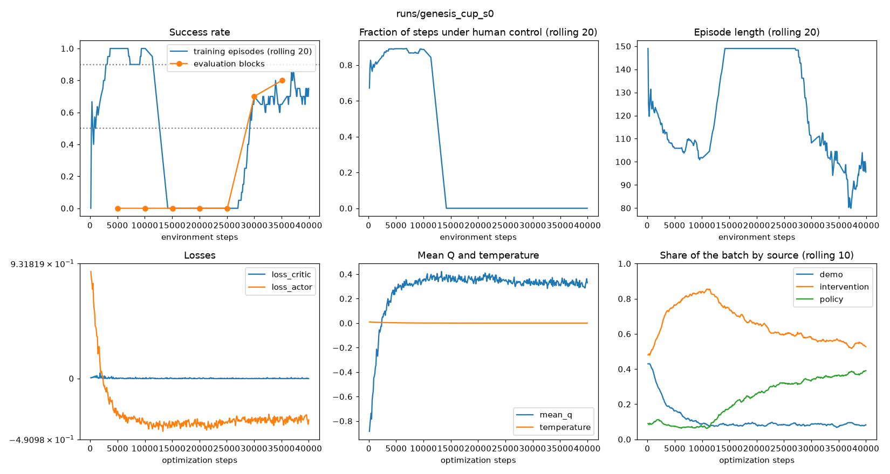
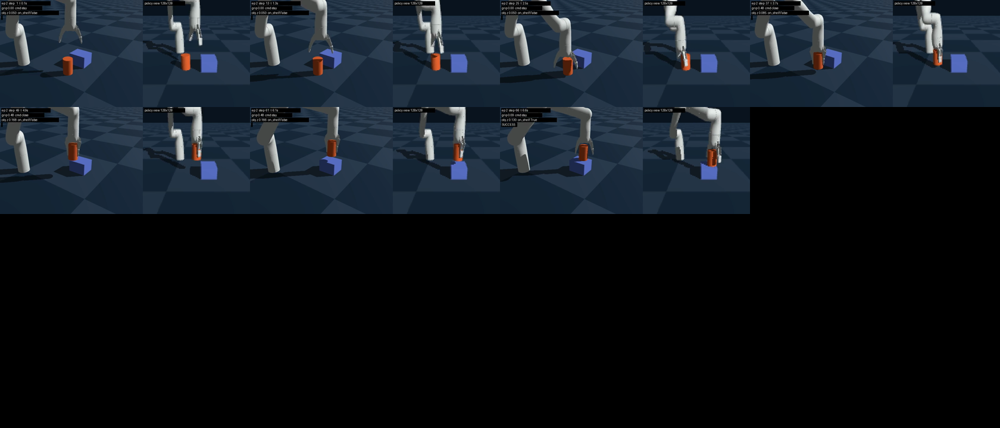
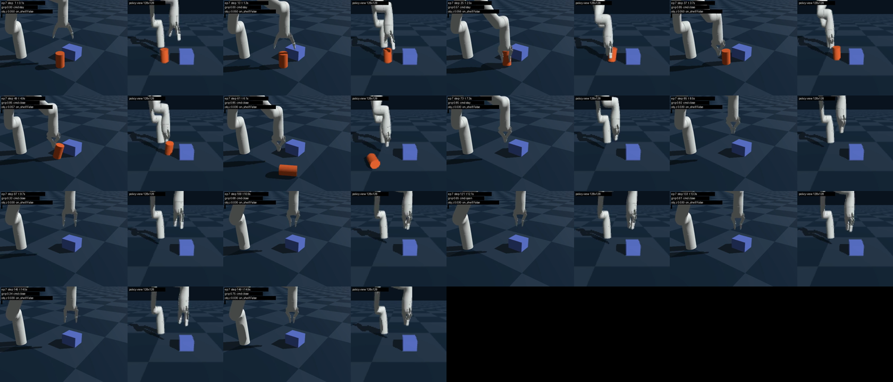
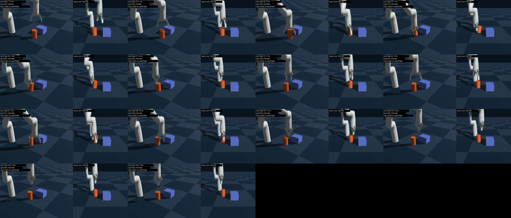

# Gen3 Lite HIL-SERL in Genesis: cylinder-to-shelf results

2026-11-18. Run `runs/genesis_cup_s0` (not in git). How the simulation is built and run: [GEN3_LITE_GENESIS.md](GEN3_LITE_GENESIS.md).

HIL-SERL learned a cylinder-to-shelf pick and place on a simulated Kinova Gen3 Lite. The policy saw only a head-on
camera and proprioception. Hands-off success reached 8/10 at 35k env steps, after 82 minutes and 40,000 env steps
of training. A separate review of the final checkpoint succeeded in 7 of 12 hands-off episodes. Every success was a
clean single attempt of about 6.5 s. Every failure began with an off-centre first grasp that the policy did not recover from.

## Setup

The sim runs the real-arm robot class (`Gen3LiteHil`) unchanged; only the layer under it is Genesis 1.4.7 instead of ROS 2.

| Part | What was used |
|---|---|
| Robot | Gen3 Lite with a Robotiq 2F-85 gripper. End-effector delta actions (1 cm per unit), IK with the tool orientation frozen top-down, workspace guard, watchdog and stale-observation checks, as on the real arm |
| Simulator | Genesis 1.4.7 on the CPU backend, stepped in real time at dt 0.01 s in its own thread. Each arm command eases to its goal over 0.2 s, like the real trajectory controller |
| Task | Orange cylinder (r 3 cm, h 10 cm, 85 g) starting at (0.32, 0.08) m ± 1 cm; blue shelf 8 cm tall centred at (0.32, 0.24) m. Success: cylinder upright on the shelf with the gripper open |
| Policy observation | 128×128 head-on camera plus proprioception (6 joints, gripper, tool xyz). No object or shelf position |
| Demonstrator | Scripted waypoint planner (`scripted_pick_place`) using privileged sim state. Gaussian noise on every motion command (std 3 mm); retries missed grasps |
| Human-in-the-loop | 20 planner demos offline. The planner took over steps 10–109 of the first 100 training episodes, then never again |
| Learner | LeRobot 0.6.1 HIL-SERL: SAC, frozen ResNet-10 encoder, discrete gripper critic, UTD 2, batch 256. Network, losses and batch mix unchanged from the real-arm cup config (`train_gen3_lite_cup.json`) |
| Episodes | 15 s at 10 Hz (149 steps), 1 s reset. Tool box x 0.24–0.40, y 0.04–0.28, z 0.05–0.24 m |
| Hardware | RTX 3080 for the learner; Genesis on CPU for the actor |

Configs: `config/hilserl/genesis_cup_env.json`, `config/hilserl/genesis_cup_train.json`.

## Training

Evaluation blocks, 10 hands-off episodes each:

| Env steps | Successes | Episodes the planner took over | Mean length (steps) |
|---|---|---|---|
| 5k | 0/10 | 10 of 10 | 106 |
| 10k | 0/10 | 7 of 10 | 114 |
| 15k | 0/10 | 0 | 149 (timeout) |
| 20k | 0/10 | 0 | 149 (timeout) |
| 25k | 0/10 | 0 | 149 (timeout) |
| 30k | 7/10 | 0 | 103 |
| 35k | 8/10 | 0 | 85 |

The 5k and 10k blocks are not a clean test of the policy. The scripted planner does not know when an evaluation
block is running and took over in most of those episodes, which count as failures.

Training episodes, grouped by 5k env steps:

| Env steps | Episodes | Successes | With a planner takeover | Policy-only successes | Mean length (steps) |
|---|---|---|---|---|---|
| 0–5k | 44 | 39 | 44 | 0 | 112 |
| 5k–10k | 38 | 36 | 38 | 0 | 106 |
| 10k–15k | 26 | 1 | 1 | 0 | 147 |
| 15k–20k | 23 | 0 | 0 | 0 | 149 |
| 20k–25k | 24 | 0 | 0 | 0 | 149 |
| 25k–30k | 29 | 15 | 0 | 15 | 120 |
| 30k–35k | 40 | 27 | 0 | 27 | 101 |
| 35k–40k | 44 | 32 | 0 | 32 | 94 |

Between 13k and 27k steps the policy reached down toward the cylinder, often within 1–2 cm of the grasp point, but closed on nothing.

Run totals:

| Metric | Value |
|---|---|
| Env steps / optimization steps | 39,949 / 40,000 |
| Wall time | 82 min |
| Episodes | 338 (268 training, 70 evaluation) |
| 50 % evaluation success | 30,004 env steps |
| 90 % evaluation success | not reached |
| Final evaluation block | 8/10 |
| Policy-only successes | 74 |
| Mean intervention fraction | 0.27 |
| Guard blocks / stale-observation stops | 0 / 0 |
| IK rejections | 152 (0.4 % of steps; a near-singular wrist region inside the box for the top-down orientation) |
| Box-clipped commands | 10,265 (the policy pushes against the box walls) |

## Review rollouts of the final checkpoint

12 hands-off episodes from the 40k checkpoint at 10 Hz, with the planner disabled. Seed 100, so the cylinder starts differ from training.

| Episode | Result | Steps | What happens |
|---|---|---|---|
| 0 | fail | 149 | Grasps beside the cylinder and keeps regrasping; nudges it about 7 cm toward the base and never lifts it |
| 1 | fail | 149 | Knocks the cylinder over on the first grasp; it rolls away and the policy keeps grasping at the empty spot by the shelf |
| 2 | success | 66 | |
| 3 | success | 67 | |
| 4 | success | 66 | |
| 5 | fail | 149 | Knocks the cylinder over; it rolls about 23 cm toward the base |
| 6 | success | 65 | |
| 7 | fail | 149 | Knocks it over at about step 55; it rolls 2.2 m out of view and the policy grasps at nothing for 9 s |
| 8 | success | 63 | |
| 9 | success | 61 | Lands near the shelf edge, slightly tilted (uprightness 0.98) |
| 10 | success | 64 | |
| 11 | fail | 149 | Pushes the cylinder toward the shelf, then hovers beside the shelf with the gripper shut |

7/12 (58 %) is below the 8/10 of the last training block; with 10–12 episodes per block the gap is within noise.
Safety counters for the 12 episodes: no guard blocks, IK rejections or stale observations.

All failures start with an off-centre first grasp. The policy then knocks the cylinder over (3 episodes) or keeps
closing on the wrong spot (2 episodes). A cylinder lying down cannot be recovered, because the planner only ever
demonstrated upright grasps.

Frames every 1.2 s (left: a side camera for review only; right: the policy's 128×128 view):

Success, episode 2:

Failure, episode 7 (knocked over):

Failure, episode 0 (repeated off-centre grasps):

The videos of all 12 episodes are in `runs/genesis_cup_s0/review_040000/` (not in git). The rollout script is
[genesis_results/eval_policy.py](genesis_results/eval_policy.py); run it from the repo root after
`LEROBOT_ENV=lerobot-ros-genesis . gen3_lite_env.sh`.

## Caveats

- One seed, nothing tuned.
- Genesis contact is more forgiving than a real plastic cup: grasps are firmer and more repeatable.
- The simulated arm settles faster than the real arm, which lags about 2 cm at 0.1 m/s.
- The object start varies by only ±1 cm, and the shelf never moves.
